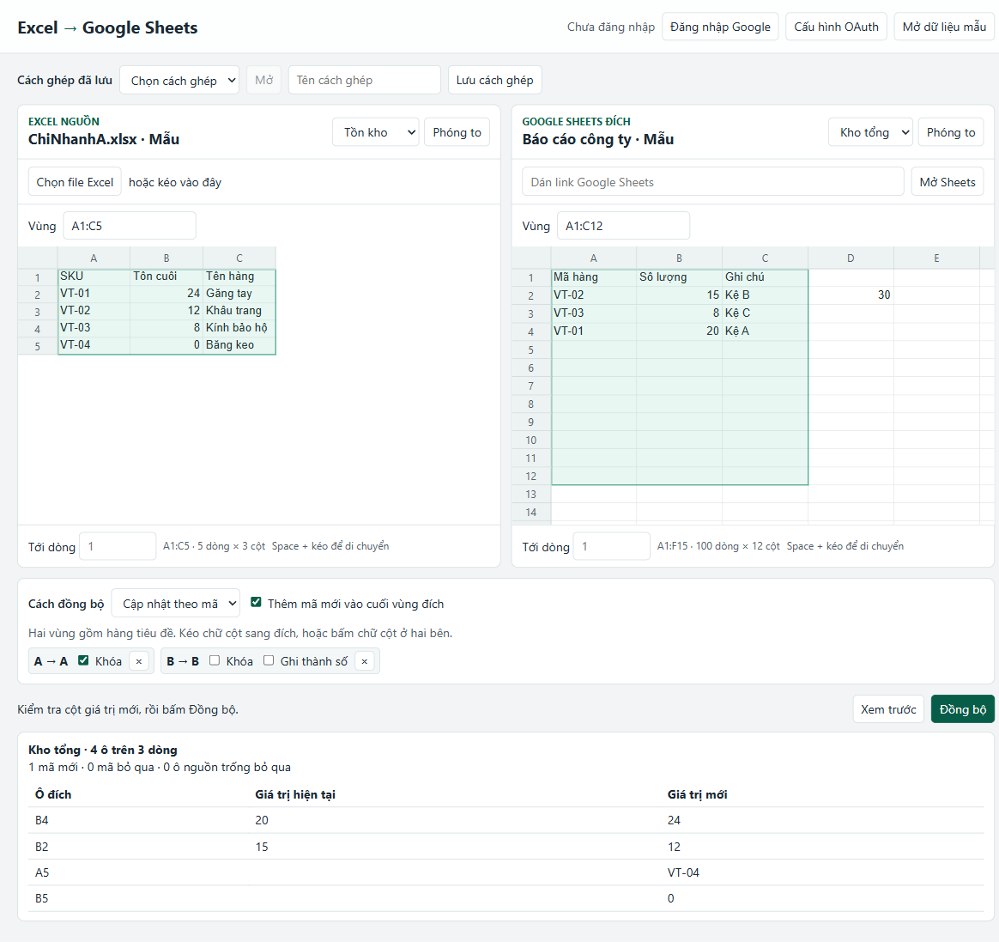

<h1 align="center">Excel Sheets Sync</h1>

<p align="center">Xem trước và gửi thay đổi từ file Excel trên máy lên Google Sheets.</p>

<p align="center"><kbd>v0.2.1</kbd> &nbsp; <kbd>Windows x64</kbd> &nbsp; <kbd>Giao diện tiếng Việt</kbd></p>

[English version](#english)



## Bắt đầu

1. Giải nén ZIP bản Windows rồi mở `ExcelSheetsSync.exe` trong thư mục đã giải nén. Giữ các file và thư mục đi kèm cạnh file thực thi. Bản chạy trực tiếp đã kèm Electron và đọc file bảng tính đã lưu.
2. Chọn **Mở dữ liệu mẫu → Xem trước → Đồng bộ**. Thao tác này cập nhật dữ liệu mẫu trong app. Mở lại dữ liệu mẫu để đặt lại.
3. Để thử kết nối thật, hoàn tất [thiết lập đăng nhập Google](#thiết-lập-đăng-nhập-google), rồi làm theo [hướng dẫn thử với bảng tồn kho](examples/README.md) bằng bộ dữ liệu giả đi kèm.

**Dùng máy Windows do công ty quản lý?** File thực thi v0.2.1 chưa được ký số. SmartScreen hoặc chính sách ứng dụng của công ty có thể hạn chế việc chạy app. [Hướng dẫn SmartScreen của Microsoft](https://learn.microsoft.com/en-us/windows/apps/package-and-deploy/smartscreen-reputation)

## Đồng bộ bảng tính

Kéo file bảng tính đã lưu vào khung **Excel nguồn**, dán link Google Sheets vào khung **Google Sheets đích**, rồi bấm **Mở Sheets**. Chọn tab và vùng muốn dùng ở mỗi bên.

| Chế độ | Cách hoạt động |
| --- | --- |
| **Chép theo vị trí** | Chọn vùng nguồn và ô trên cùng bên trái của vùng đích. App ghi từng giá trị vào vị trí tương ứng tính từ ô đó. |
| **Cập nhật theo mã** | Chọn vùng có một hàng tiêu đề ở đầu mỗi bên. Ghép cột bằng cách kéo chữ cột hoặc bấm lần lượt chữ cột nguồn và cột đích. Đánh dấu **Khóa** cho một hoặc nhiều cặp để tìm đúng dòng dù thứ tự hai bên khác nhau. |

Bấm **Xem trước** để kiểm tra thay đổi, rồi bấm **Đồng bộ** để ghi. Đặt tên và bấm **Lưu cách ghép** để dùng lại trên cùng hồ sơ Windows.

- **Thêm mã mới vào cuối vùng đích** điền dữ liệu vào các dòng còn trống cuối vùng đích đã chọn. Chừa các dòng trống trong vùng đó và ghép tất cả cột muốn điền.
- **Ghi thành số** chuyển văn bản theo định dạng Việt Nam như `22.000.000 ₫` thành giá trị số trong cột dữ liệu đã ghép. Các cột khóa giữ nguyên mã định danh.
- **Phóng to** mở rộng một khung ra toàn chiều ngang và thu khung kia thành bản xem nhỏ ở góc. Bấm bản xem nhỏ để đổi bên. Bấm **Chia đôi** hoặc `Esc` để về chế độ mặc định.
- Dùng thanh cuộn hoặc touchpad để di chuyển theo hai chiều. Giữ `Shift` và lăn chuột để cuộn ngang, hoặc giữ `Space` rồi kéo để di chuyển bảng. Kéo vùng chọn sát mép lưới để mở rộng vùng ra ngoài phần đang hiển thị.

## Thiết lập đăng nhập Google

Tạo một **OAuth client loại Desktop app** cho app. Mỗi người thử dùng tài khoản Google riêng và quyền truy cập file đã được cấp cho tài khoản đó.

1. Chọn hoặc tạo project Google Cloud rồi bật [Google Sheets API](https://console.cloud.google.com/apis/library/sheets.googleapis.com).
2. Thiết lập [Google Auth Platform](https://console.cloud.google.com/auth/overview). Nếu app thuộc loại **External** và đang ở chế độ **Testing**, thêm từng người thử vào **Audience → Test users**. Ở chế độ này, quyền truy cập Sheets mà người dùng cấp cho app hết hạn sau bảy ngày. [Hướng dẫn kiểm thử OAuth của Google](https://support.google.com/cloud/answer/15549945?hl=en)
3. Mở [Clients](https://console.cloud.google.com/auth/clients), tạo OAuth client loại **Desktop app**, rồi tải file JSON của client đó. [Hướng dẫn tạo thông tin xác thực của Google](https://developers.google.com/workspace/guides/create-credentials#desktop-app)
4. Trong app, bấm **Đăng nhập Google → Chọn JSON và đăng nhập**. Cũng có thể đặt file JSON với tên `google-oauth.json` cạnh file thực thi trước khi mở app. Nếu chạy từ mã nguồn, đặt file ở thư mục gốc của dự án.
5. Đăng nhập bằng tài khoản có quyền đọc bảng đích. Để đồng bộ, tài khoản cần quyền **Editor** và quyền chỉnh sửa các ô đã chọn.

Giữ file OAuth JSON, token và bảng tính làm việc ngoài Git. Windows lưu phiên đăng nhập Google đã mã hóa, cách ghép và lịch sử đồng bộ tại `%APPDATA%\Excel Sheets Sync`. App gửi các thay đổi đã chọn trực tiếp đến Google Sheets API. Cách ghép và phiên đăng nhập được lưu theo hồ sơ Windows.

> **Gặp lỗi 403 `access_denied` khi đăng nhập?** Kiểm tra email đăng nhập có trong **Test users** của đúng project đã tạo OAuth client đã nhập vào app. Nếu phát hành rộng hơn, xem yêu cầu của Google đối với [quyền truy cập Sheets thuộc nhóm nhạy cảm](https://developers.google.com/workspace/sheets/api/scopes).

## Build và kiểm thử

Dùng Windows x64 với Node.js **22.12 trở lên** và npm.

```powershell
npm.cmd ci
npm.cmd start
npm.cmd test
npm.cmd run test:desktop
npm.cmd run package:win
```

Bài kiểm thử desktop dùng dữ liệu tạo sẵn, hồ sơ app tạm và phản hồi Google mô phỏng. Bản build nằm ở `release/ExcelSheetsSync-win32-x64`. Để phân phối, nén ZIP toàn bộ thư mục đầu ra. Git bỏ qua thư mục `release/`.

## Phạm vi v0.2.1

- Người dùng bấm nút để đồng bộ một chiều vào tab Google Sheets có sẵn. File nguồn hỗ trợ `.xlsx`, `.xlsm`, `.xls`, `.xlsb`, `.csv` và `.tsv`, tối đa 35 MiB mỗi file và 30.000 ô mỗi vùng chọn.
- App ghi giá trị ô, bao gồm kết quả công thức đã lưu trong file Excel. App bỏ qua ô nguồn trống, giữ số 0, báo mã trùng và chặn ghi lên ô đích chứa công thức, kết quả công thức hoặc thuộc vùng ô gộp. Google Sheets áp dụng định dạng số hiện có ở đích.
- Bản xem trước hiển thị định dạng cơ bản và ô gộp. Biểu đồ, ảnh nhúng và khung hàng hoặc cột cố định nằm ngoài phạm vi hiển thị.
- App kiểm tra lại các thay đổi dự kiến trước khi ghi. Khi nhiều người dùng cùng lúc, giao cho mỗi người các hàng hoặc vùng đích riêng để tránh ghi đè lên nhau.

---

<a id="english"></a>

<h1 align="center">Excel Sheets Sync</h1>

<p align="center">Preview and send changes from a local Excel file to Google Sheets.</p>

<p align="center"><kbd>v0.2.1</kbd> &nbsp; <kbd>Windows x64</kbd> &nbsp; <kbd>Vietnamese interface</kbd></p>


## Get started

1. Extract the Windows release ZIP and open `ExcelSheetsSync.exe` from the extracted folder. Keep the runtime files and folders beside the executable. The portable build includes Electron and reads saved workbooks directly.
2. Choose **Open demo data** (*Mở dữ liệu mẫu*) → **Preview** (*Xem trước*) → **Sync** (*Đồng bộ*). This updates the in-app sample. Opening the demo again resets it.
3. To try a real connection, complete [Google sign-in setup](#google-sign-in-setup), then follow the [inventory walkthrough](examples/README.md) with the included fictional data.

**Using a managed Windows PC?** The v0.2.1 executable is unsigned. SmartScreen or your organization's application policy may restrict running it. [Microsoft SmartScreen guidance](https://learn.microsoft.com/en-us/windows/apps/package-and-deploy/smartscreen-reputation)

## Sync a workbook

Drag a saved workbook into the **Excel source** pane, paste a Google Sheets URL into the **Google Sheets destination** pane, and click **Open Sheets** (*Mở Sheets*). Select the tabs and ranges you want to use.

| Mode | How it works |
| --- | --- |
| **Copy by position** (*Chép theo vị trí*) | Select a source range and the top-left destination cell. The app places values at the corresponding offsets. |
| **Match by key** (*Cập nhật theo mã*) | Include one header row at the top of both ranges. Pair the columns by dragging their letters or clicking the source and destination letters in order. Mark one or more pairs as **Key** (*Khóa*) to match rows even when the order differs. |

Review **Preview**, then click **Sync** to apply the proposed changes. Give the mapping a name and choose **Save mapping** (*Lưu cách ghép*) to reuse it on the same Windows profile.

- **Add new keys** (*Thêm mã mới vào cuối vùng đích*) fills available rows at the end of the selected destination range. Include blank rows in that range and map every column you want to populate.
- **Write as number** (*Ghi thành số*) converts Vietnamese-formatted text such as `22.000.000 ₫` into a numeric value in a mapped data column. Key columns retain their identifiers.
- **Expand** (*Phóng to*) opens either pane at full width with the other pane in a small corner preview. Click the small preview to switch sides. Use **Split** (*Chia đôi*) or `Esc` to return to the default view.
- Use the scrollbars or a touchpad to move in both directions. Use `Shift` + wheel for horizontal scrolling, or hold `Space` and drag to pan. Drag a selection to the grid edge to extend it beyond the visible area.

## Google sign-in setup

Create one **Desktop app OAuth client** for the app. Each tester uses their own Google account and the file permissions granted to that account.

1. Select or create a Google Cloud project and enable the [Google Sheets API](https://console.cloud.google.com/apis/library/sheets.googleapis.com).
2. Set up [Google Auth Platform](https://console.cloud.google.com/auth/overview). For an **External** app in **Testing**, add each tester under **Audience → Test users**. Google authorizations for the requested Sheets scope expire after seven days in that mode. [Google OAuth testing guidance](https://support.google.com/cloud/answer/15549945?hl=en)
3. Open [Clients](https://console.cloud.google.com/auth/clients), create an OAuth client with the **Desktop app** type, and download its JSON file. [Google credential setup](https://developers.google.com/workspace/guides/create-credentials#desktop-app)
4. In the app, click **Sign in with Google** (*Đăng nhập Google*) → **Choose JSON and sign in** (*Chọn JSON và đăng nhập*). Alternatively, place the desktop client JSON beside the portable executable as `google-oauth.json` before launch. For a source checkout, place it in the project root.
5. Sign in with an account that can read the destination. To sync, the account needs **Editor** access and permission to edit the selected cells.

Keep OAuth JSON files, tokens, and working spreadsheets outside version control. Windows stores the app's encrypted Google session, saved mappings and sync history under `%APPDATA%\Excel Sheets Sync`. The app sends the selected updates directly to the Google Sheets API. Saved mappings and sign-in sessions are local to the Windows profile.

> **403 `access_denied` while signing in?** Check that the signed-in email is listed under **Test users** in the same project as the imported OAuth client. For wider distribution, review Google's requirements for the app's [sensitive Sheets scope](https://developers.google.com/workspace/sheets/api/scopes).

## Build and test

Use Windows x64 with Node.js **22.12+** and npm.

```powershell
npm.cmd ci
npm.cmd start
npm.cmd test
npm.cmd run test:desktop
npm.cmd run package:win
```

The desktop smoke test uses generated data, a temporary app profile, and simulated Google responses. The release build is written to `release/ExcelSheetsSync-win32-x64`. To distribute it, ZIP the entire output folder. The `release/` directory is ignored by Git.

## Scope of v0.2.1

- Manual, one-way sync into an existing Google Sheets tab. Sources can be `.xlsx`, `.xlsm`, `.xls`, `.xlsb`, `.csv`, or `.tsv`, up to 35 MiB and 30,000 cells per selected range.
- Sync writes cell values, including cached Excel formula results. It skips blank source cells, preserves zero, flags duplicate keys, and blocks writes into destination formula cells, formula results, or merged cells. Google Sheets applies the destination's existing number format.
- Preview shows basic formatting and merged cells. Charts, embedded images, and frozen panes are outside the preview's scope.
- The app rechecks the plan before writing. For simultaneous use, assign distinct destination rows or ranges to each editor to avoid races on shared cells.
